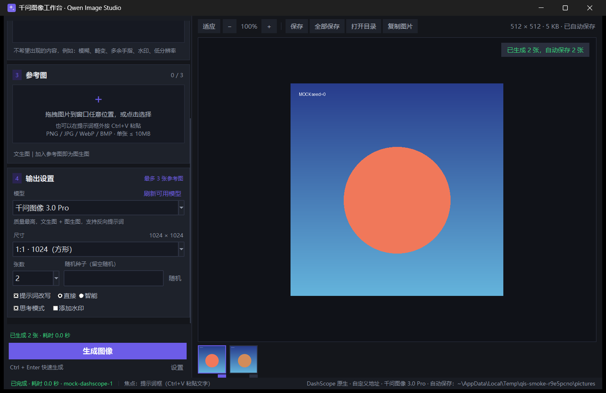
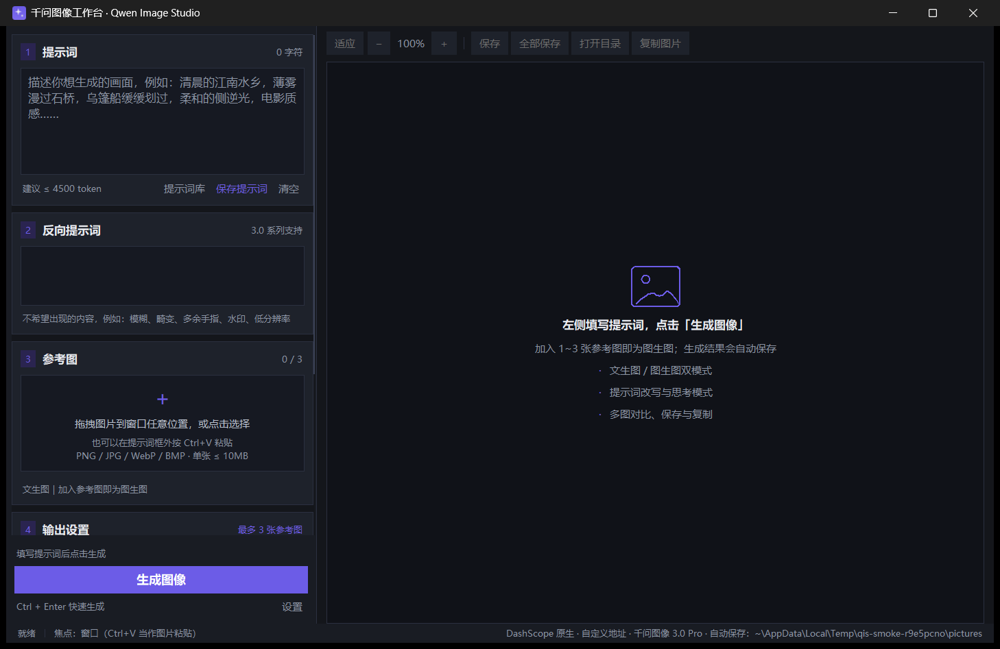
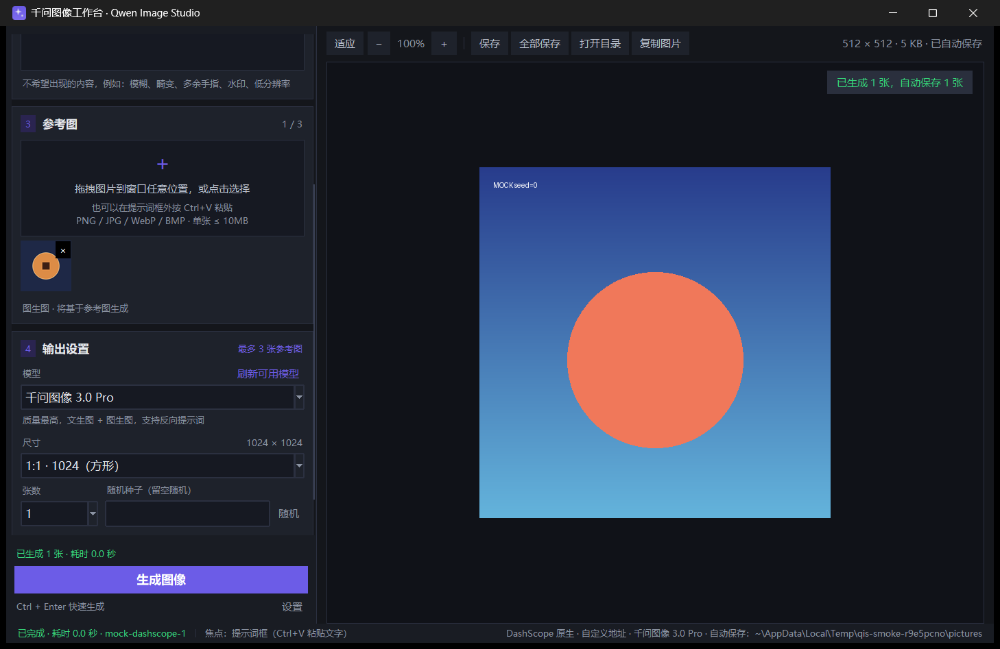
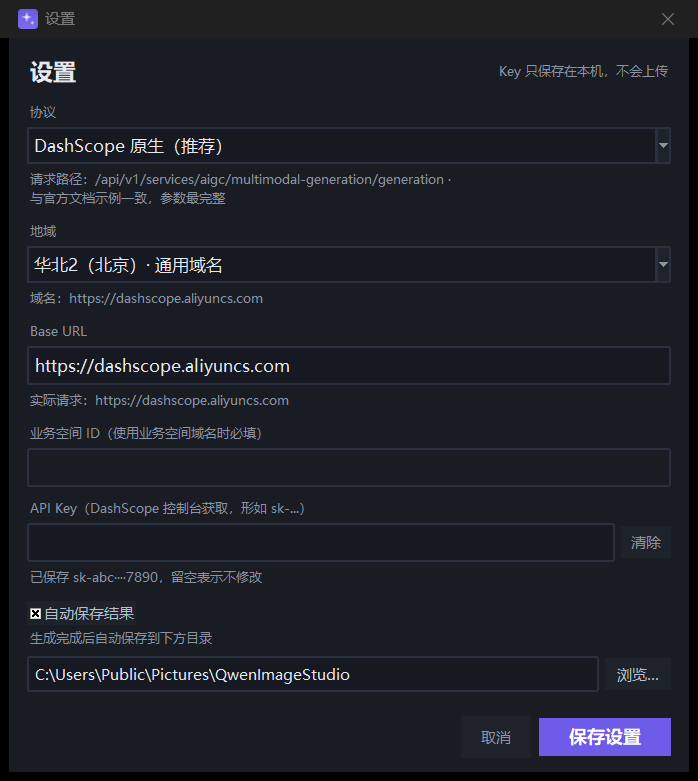
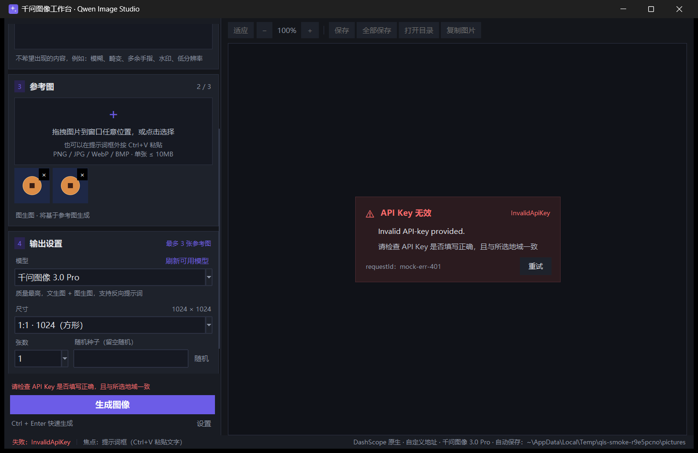
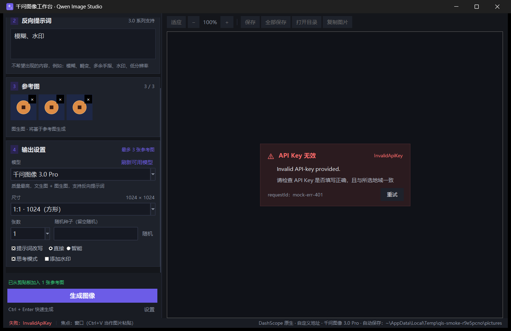
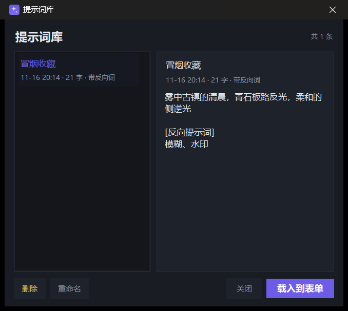
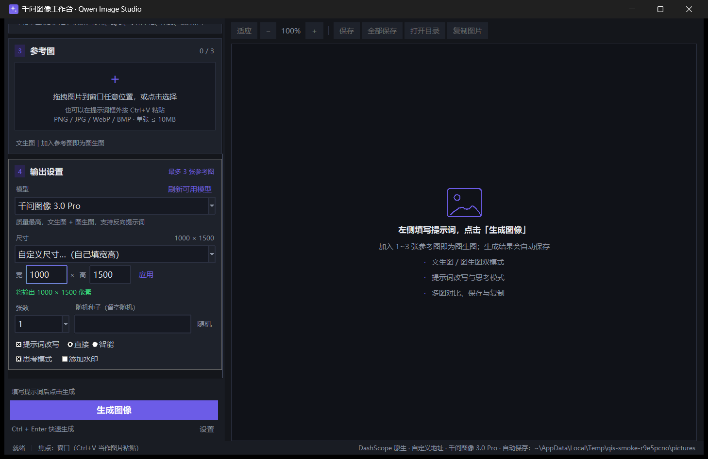
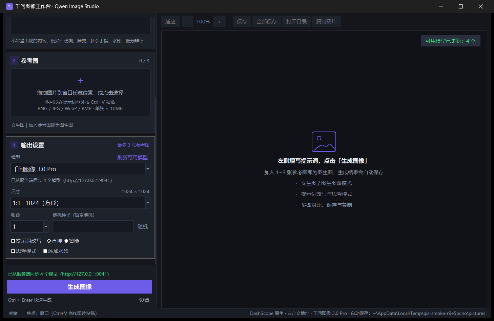

<p align="center">
  
</p>

<h1 align="center">千问图像工作台 · Qwen Image Studio</h1>

<p align="center">一个离线的、双击就能打开的桌面小工具：左边填参数，右边出图预览。</p>

<p align="center">
  
</p>

---

## 快速开始

1. 确认电脑里有 **Python 3.11+**（Windows 商店版、python.org 版、自装在 `C:\environment\python` 都行）。
2. 双击 **`启动.vbs`**（文件管理器里显示为「Windows 脚本宿主」；也可以双击 `run.bat`），窗口就会打开，不会弹出黑框。
   - 启动顺序：先找 PATH 里的 `pythonw.exe`，再试 `%LOCALAPPDATA%\Microsoft\WindowsApps`、`C:\environment\python`、`%LOCALAPPDATA%\Programs\Python`、`C:\Python3xx` 等固定位置（这样即使 PATH 坏了也能起来）。
3. 如果提示缺少 `requests` / `Pillow`，按弹窗提示装一次即可：`python -m pip install -r requirements.txt`。
4. 第一次打开会自动弹出「设置」：
   - 在 **API Key** 里填阿里云百炼（DashScope）的 Key，形如 `sk-xxxxxxxx`；
   - 地域默认「华北2（北京）· 通用域名」，一般不用改；
   - 点「保存设置」。Key 只保存在本机，不会上传到别处。
5. 左边写提示词 → 点「生成图像」（或按 `Ctrl + Enter`），右边出图。

> 没有 Key 也能打开界面，只是生成时会提示先配置 Key。

## 界面预览

| 空白状态 | 图生图（带参考图） |
| --- | --- |
|  |  |

| 出错时的样子（会给出中文原因） | 设置对话框 |
| --- | --- |
|  |  |

| 正在输入哪个框一眼可见 | 粘贴/拖入的图直接变参考图 |
| --- | --- |
|  |  |

| 提示词库：收藏与一键载入 | 自定义尺寸（自己填宽高） |
| --- | --- |
|  |  |

| 从服务端刷新可用模型 |
| --- |
|  |

## 功能

**左侧表单**

- 提示词输入框，实时显示字数与 token 估算，一键清空。
- **提示词库**：写好的提示词可以「保存提示词」存成收藏（连反向提示词一起存），以后点「提示词库」选一条就整段载回表单；存在 `%APPDATA%\QwenImageStudio\prompts.json`，支持重命名和删除。
- 反向提示词（3.0 系列模型可用）。
- 参考图：**把图片直接拖进窗口**、点「+」选文件、或按 `Ctrl + V` 粘贴（剪贴板里的图片/图片文件都行）；最多 3 张（2.1 系列最多 10 张），可单张移除；带 1 张以上参考图时自动切成图生图。
- 焦点指示：正在输入的框会用紫色描边高亮，底部状态栏同时显示「焦点：提示词框（Ctrl+V 粘贴文字）」，所以按 `Ctrl + V` 时不会再犹豫贴到哪。
- 输出设置：
  - **模型**：内置 3.0 Pro / 3.0 / 2.1 Pro / 2.1 Turbo；右上角「刷新可用模型」会带上你的 Key 去服务端拉一次模型列表，把新出的 qwen-image 系列（含带日期快照的版本）合并进下拉框，并记住到下次启动。
  - **尺寸**：23 个预设（自动 / 1:1 / 4:3 / 3:2 / 16:9 / 2:1 / 3:4 / 2:3 / 9:16 / 1:2，从 512 到 2048），以及「自定义尺寸」——自己填宽、高，实时提示合法性与最终像素，范围 512×512 ~ 2048×2048、宽高比 ≤ 8:1。「自动」不再下发 size，交给模型自己挑，不会再报 `InvalidParameter`。
  - 张数 1~6、随机种子、提示词改写（直接 / 智能）、思考模式、水印。
- 生成 / 取消；状态一行提示（成功、失败、参数问题都会中文说明）。

**右侧预览**

- 适应窗口 / 缩放 / 滚轮缩放；多图缩略条切换对比。
- 保存当前图、全部保存、打开所在目录、复制图片到剪贴板。
- 生成结果默认自动保存到「图片\QwenImageStudio」（可在设置里改或关掉）。
- 失败时显示错误码 + 中文原因 + 重试按钮，并附 requestId 方便排查。

**其它**

- 窗口大小、所有设置都会记住，下次打开还原。
- 快捷键：

  | 按键 | 作用 |
  | --- | --- |
  | `Ctrl + Enter` / `F5` | 生成（重试） |
  | `Esc` | 取消生成（进行中） |
  | `Ctrl + V` | 焦点在输入框里就贴文字；否则把剪贴板里的图片贴成参考图 |
  | `Ctrl + S` | 保存当前图 |
  | `Ctrl + ,` | 打开设置 |

## 支持的两套接口

设置里可切换「协议」：

- **DashScope 原生（推荐）**：`POST {base}/api/v1/services/aigc/multimodal-generation/generation`，参数放在 `parameters` 里，与《千问-图像生成与编辑 API参考》示例一致。
- **OpenAI 兼容**：`POST {base}/compatible-mode/v1/images/generations`，参数平铺在请求体顶层。

地域可选北京 / 新加坡通用域名，也可选「业务空间域名」并填 WorkspaceId，或干脆「自定义地址」。

## 项目结构

```
qwen-image-desktop/
├─ 启动.vbs              # 双击启动（无黑框；先找 PATH 里的 pythonw，再找常见安装位置）
├─ run.bat               # 备用入口（同样效果，失败时自动转发给 启动.vbs）
├─ requirements.txt       # 两个依赖：pillow / requests
├─ app.py                 # 主窗口：布局、生成线程、队列回传、首启动引导
├─ ui_theme.py            # 配色 / 字体 / ttk 样式 / 卡片 / 自绘滚动条
├─ ui_form.py             # 左侧表单面板
├─ ui_preview.py          # 右侧预览面板（缩放、缩略图、保存、复制）
├─ ui_settings.py         # 设置对话框
├─ ui_prompt_library.py   # 提示词库对话框 + 命名对话框
├─ prompt_store.py        # 提示词收藏读写（%APPDATA%\QwenImageStudio\prompts.json）
├─ api.py                 # 请求构造、发送、响应解析、错误映射（永不抛异常）
├─ meta.py                # 模型 / 尺寸 / 地域 / 协议 / 限制常量表
├─ settings.py            # 配置读写（%APPDATA%\QwenImageStudio\settings.json）
├─ storage.py             # 自动保存目录与文件命名
├─ clipboard_win.py       # 读剪贴板里的图片/文件（Win32 API）
├─ assets/app.ico         # 应用图标
└─ test/
   ├─ mock_server.py      # 假 API 服务（生成真实 PNG，供离线联调）
   ├─ smoke.py            # 端到端冒烟：开真窗口、跑文生图/图生图/错误态/设置
   └─ out/                # 冒烟产出的截图与报告
```

依赖只有 `requests` 和 `Pillow`。缺了的话双击启动会弹窗告诉你要装什么，也可以手动：

```bat
python -m pip install -r requirements.txt
```

## 打包分发

双击 `打包.bat`：会复制一份干净的目录（跳过 `__pycache__`、`test\out`）压成 `qwen-image-studio-日期-时间.zip`，发给别人解压后双击 `启动.vbs` 就能用。注意**不要带上 `%APPDATA%\QwenImageStudio\settings.json`**（里面有你的 Key），本仓库默认也不包含它。

## 离线自测

不需要 Key、不花额度，本地假服务会返回真实 PNG：

```bat
python test\smoke.py
```

它会：隔离一份临时配置 → 打开真实窗口 → 走一遍文生图、图生图、错误态、设置开关、尺寸/自定义尺寸、模型刷新、提示词库、粘贴与拖放 → 把截图写到 `test\out\`，最后打印 `结果：84 passed, 0 failed`。

只想启动假服务手点：

```bat
python test\mock_server.py
```

然后在应用的「设置」里把 Base URL 改成假服务地址（打印里会给出 `http://127.0.0.1:端口`），Key 随便填。

## 常见问题

| 现象 | 原因 / 处理 |
| --- | --- |
| 提示「API Key 无效 `InvalidApiKey`」 | Key 抄错、Key 已过期，或者 Key 与所选地域不匹配（北京 Key 用了新加坡域名）。 |
| 提示「额度不足 `Throttling` / 余额不足」 | 百炼控制台看下免费额度或余额。 |
| 提示「请求超时」 | 出图本来就慢（10~60 秒），网络差或一次要 6 张都容易超时；减少张数或换网络。 |
| 一直停在「正在请求模型…」 | 检查能否访问 `dashscope.aliyuncs.com`；公司网络/代理可能需要先关代理。 |
| 点「刷新可用模型」提示失败 | 需要先保存 API Key；报 401 就是 Key 不对。刷新只保留 `qwen-image` 系列模型，别的系列（wan、z-image 等）不显示。 |
| 想固定几个常用提示词 | 提示词框下面「保存提示词」存起来，「提示词库」里点一条即可载回（含反向提示词）。 |
| 生成成功但找不到图 | 图会自动存到「图片\QwenImageStudio」，点预览区上方「打开目录」就能看到；也可在设置里改保存目录。 |
| 双击 `启动.vbs` 后什么都没发生 | 多数是没装 Python 或 PATH 里没有。`启动.vbs` 会先沿 PATH 找 `pythonw.exe`，再试 `%LOCALAPPDATA%\Microsoft\WindowsApps`、`C:\environment\python`、`%LOCALAPPDATA%\Programs\Python`、`C:\Python3xx` 等位置；都找不到会弹窗提示。也可以用 `where python` 查真实位置。 |
| 双击 `run.bat` 报「不是内部或外部命令」 | 这台机器的 PATH 被破坏过（之前系统 PATH 里多了一个引号，导致 cmd 解析后面的目录全部失效）。修好后 `run.bat` 就正常；万一再坏，直接用 `启动.vbs`（它不依赖 cmd 的 PATH 解析）。 |
| 提示缺少 `requests` / `PIL` | 双击启动时会弹窗写明要执行的命令；或 `python -m pip install -r requirements.txt`。 |

## 说明

- 本工具只是把文档里的接口包了一层界面，所有生成都在你自己的机器上直连阿里云完成。
- 参数与错误码对照《千问-图像生成与编辑 API参考》，模型 ID、尺寸约束、`n` 的 1~6 范围等都按文档来。
- 界面用 tkinter 实现，所以启动快、不用装浏览器/运行时；代价是控件质感偏朴素。
- 实测环境：Python 3.13（Windows 商店版）+ Tk 8.6、Python 3.15 + Tk 9.0 / Pillow 13，两套都跑过 `test\smoke.py` 的 85 项检查。
